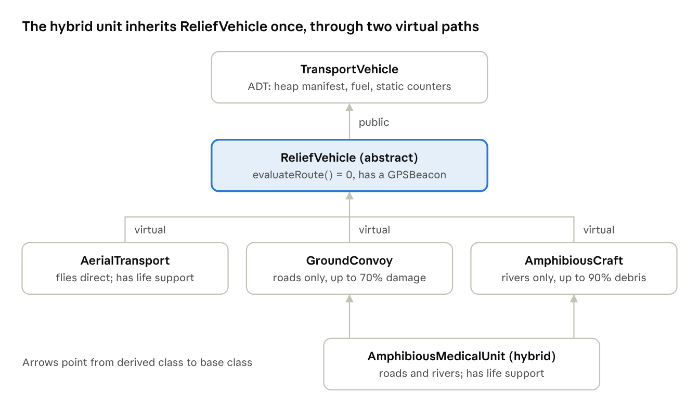

# ERL-HUB — Post-Earthquake Multi-Agency Emergency Relief Logistics Hub

Project Assignment (Option 2) for **Object-Oriented Programming Using C++ (CIC-211)**
Department of Computer Science and Engineering, Maharaja Agrasen Institute of Technology

| Team member | Enrolment no. | Class roll |
| --- | --- | --- |
| Aanya Rustagi | 33814802725 | C-17 |
| Chaitanya Anand | 35414802725 | C-18 |

## What it does

After an earthquake, a field hub has to push limited supplies (trauma medicine, ration
kits, water tanks, blankets) to cut-off sites using very different vehicles: truck
convoys, helicopters, quadcopters, boats and an amphibious medical unit. ERL-HUB models
that hub in standard C++:

- a **depot** that tracks stock and holds a locked strategic reserve,
- a **fleet** of five vehicle types that each judge a damaged corridor differently,
- a **triage queue** that serves the most urgent request first,
- a **dispatcher** that picks the fastest vehicle able to reach the site, and
- a **binary transit log** saved with atomic file replacement.

## Build and run

Needs only a C++11 compiler (tested with g++ 13 and clang++ as C++11, C++14 and C++17).

```bash
make            # builds ./erl_hub
./erl_hub       # guided demonstration of Units I-IV
./erl_hub --menu  # interactive coordinator console
make test       # builds and runs the 71 self-checks
make clean
```

Without `make`:

```bash
g++ -std=c++11 -Wall -Wextra -pedantic -Iinclude src/*.cpp -o erl_hub
```

With CMake (Windows / Visual Studio / CLion):

```bash
cmake -S . -B build && cmake --build build
```

To build as another standard: `make clean && make STD=c++17`.

The full output of the demonstration is saved in [`docs/sample_output.txt`](docs/sample_output.txt).

## Repository layout

```
ERL-HUB/
├── include/                  class declarations (one header per module)
│   ├── Utils.h               inline maths + stream manipulators
│   ├── Exceptions.h          exception hierarchy
│   ├── ReliefCargo.h         cargo ADT and its operators
│   ├── DistributionDepot.h   stock ledger (+=, -=, reserve)
│   ├── Components.h          GPSBeacon, EmergencyLifeSupportUnit
│   ├── TransportVehicle.h    dynamic manifest, static analytics
│   ├── ReliefVehicle.h       inheritance tree and hybrid vehicle
│   ├── PriorityDispatchQueue.h  template queue + triage functor
│   ├── Allocation.h          overloaded allocateSupply()
│   ├── IncidentCommander.h   friend class
│   ├── AuditLog.h            binary transit log and manifest files
│   ├── ReliefHub.h           dispatcher that ties everything together
│   └── Scenario.h            sample data
├── src/                      implementations + main.cpp
├── tests/test_erl_hub.cpp    self-checking tests
├── docs/                     sample output, class diagram, project report (PDF)
├── Makefile, CMakeLists.txt
└── .github/workflows/build.yml   CI: build + test as C++11/14/17
```

## Class design



```
                 TransportVehicle            ADT: heap manifest, fuel, static counters
                        |
                  ReliefVehicle              abstract: evaluateRoute() = 0, has-a GPSBeacon
              /  virtual |  virtual \ virtual
   AerialTransport  GroundConvoy  AmphibiousCraft
   (has-a life            \          /
    support unit)     AmphibiousMedicalUnit  hybrid: one shared ReliefVehicle base
```

Namespaces: `ReliefOps::Inventory` (cargo, depot), `ReliefOps::Logistics` (vehicles,
queue, allocation), `ReliefOps::Persistence` (files), `ReliefOps::Util` (helpers).

## Where each syllabus requirement is implemented

| Unit | Requirement | Where to look |
| --- | --- | --- |
| I | Namespaces `ReliefOps::Logistics`, `ReliefOps::Inventory` | every header |
| I | Function overloading for supply allocation | `allocateSupply()` in `Allocation.h` (payload-kg version and `TriageRequest` version) |
| I | Call by reference / return by reference | `DistributionDepot::stockOf()`, `GPSBeacon::moveTo()`, `GPSBeacon::readFix()` |
| I | Inline utilities | `Utils.h` (`distanceKm`, `payloadKg`, `etaHours`, `fuelNeededLitres`) |
| I | Friend class `IncidentCommander` | friend grants in `DistributionDepot.h`, `TransportVehicle.h`; use in `IncidentCommander.cpp` |
| II | ADTs `ReliefCargo`, `DistributionDepot`, `TransportVehicle` | their headers (private data, const getters) |
| II | Static members and functions | `TransportVehicle::operationalVehicles()`, `dispatchedTonnes()` |
| II | Dynamic constructor, copy constructor, destructor | `TransportVehicle.cpp` (`new[]`, deep copy, `delete[]`, `grow()`) |
| II | `+=`, `-=`, `==`, `<<`, `>>` | `ReliefCargo`, `DistributionDepot`, `TransportVehicle::operator==` |
| III | `ReliefVehicle` → Aerial / Ground / Amphibious | `ReliefVehicle.h` |
| III | Hybrid vehicle with virtual base classes | `AmphibiousMedicalUnit` |
| III | Containership | `GPSBeacon` inside `ReliefVehicle`; `EmergencyLifeSupportUnit` inside `AerialTransport` and `AmphibiousMedicalUnit` |
| III | Runtime polymorphism, virtual destructors | `ReliefHub::serve()`, `ReliefHub::releaseFleet()` |
| IV | Exceptions derived from `std::exception` | `Exceptions.h` (5 classes under `ReliefException`) |
| IV | Binary `std::fstream`, atomic updates | `TransitLog::commit()`, `load()`, `amendStatus()` in `AuditLog.cpp` |
| IV | Template `PriorityDispatchQueue<T>` | `PriorityDispatchQueue.h` |
| IV | `std::vector`, `std::unordered_map`, algorithms | `ReliefHub`, `DistributionDepot`, `main.cpp` |
| IV | Functors | `TriageUrgency`, `WeightAccumulator` |
| IV | User-defined manipulators | `tableRule`, `fixed2`, `col(n)`, `num(n)` in `Utils.h` |

## Testing

`make test` runs 71 checks covering operators, deep copy, reallocation, each exception,
route evaluation for every vehicle type, the diamond base, queue ordering and file
round-trips. The program has also been run under AddressSanitizer, UndefinedBehaviorSanitizer
and Valgrind with no leaks or errors reported.

## Licence

MIT — see [LICENSE](LICENSE).
